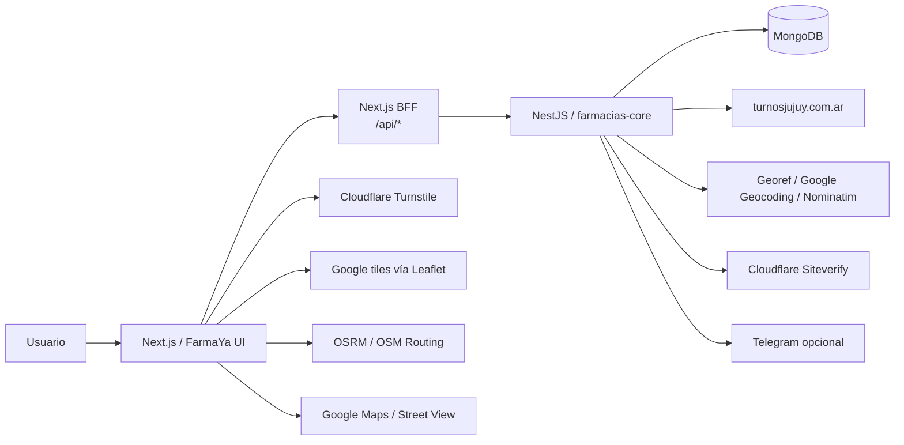
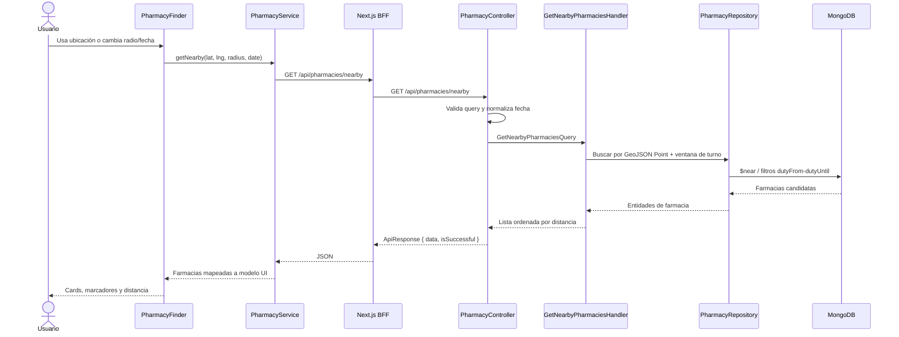
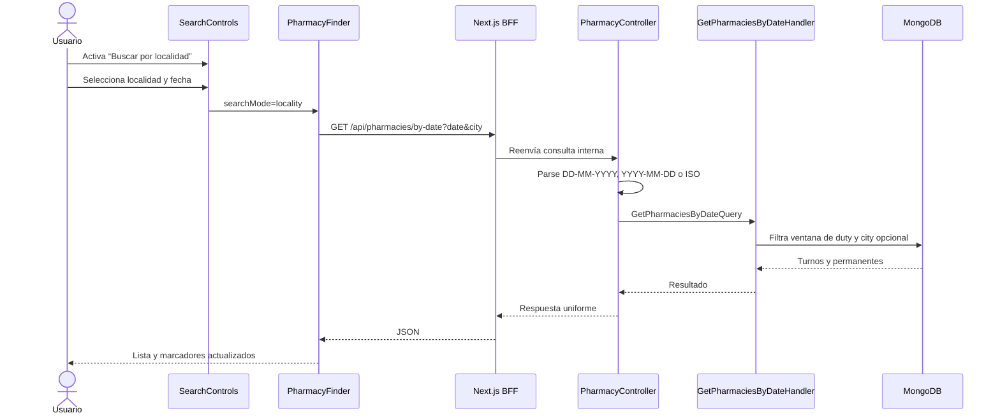
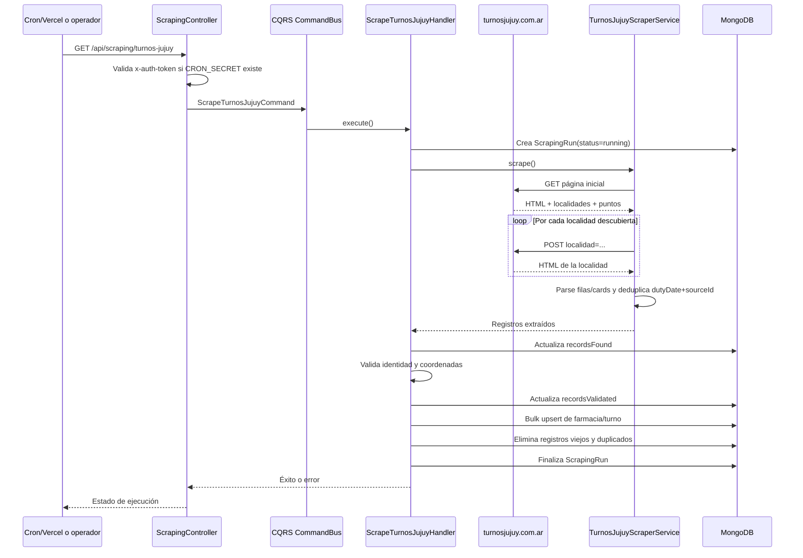
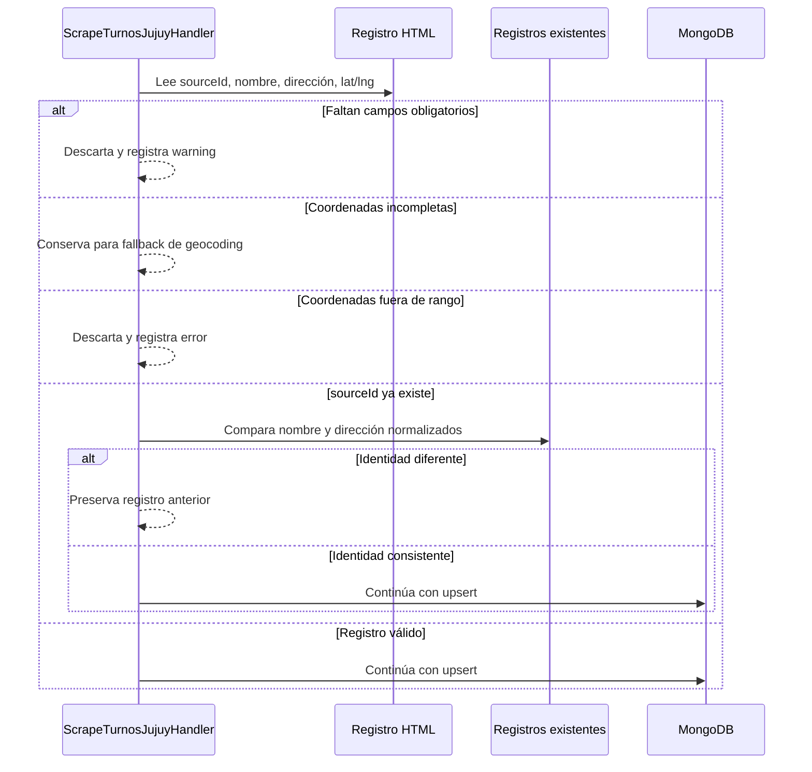
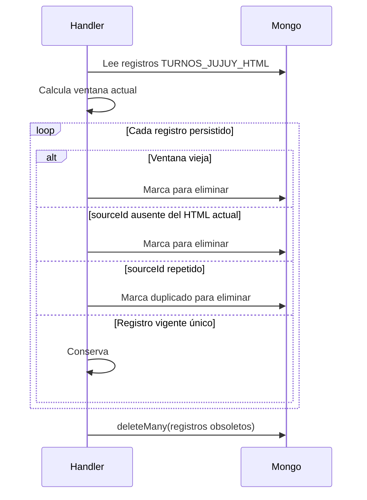
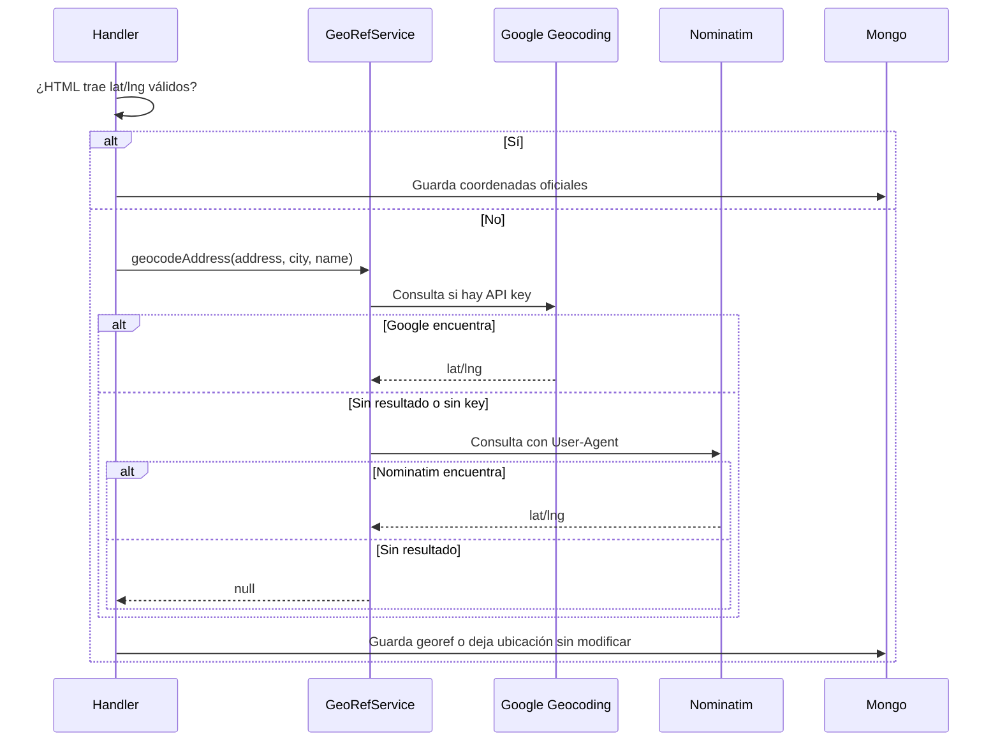
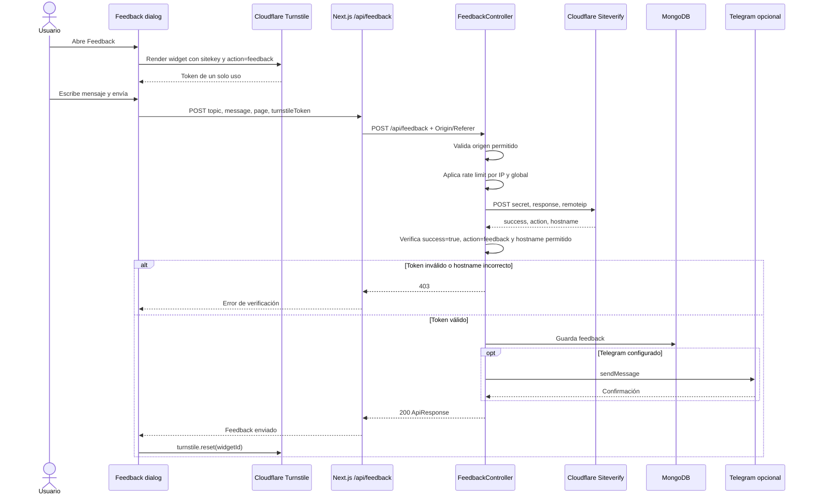
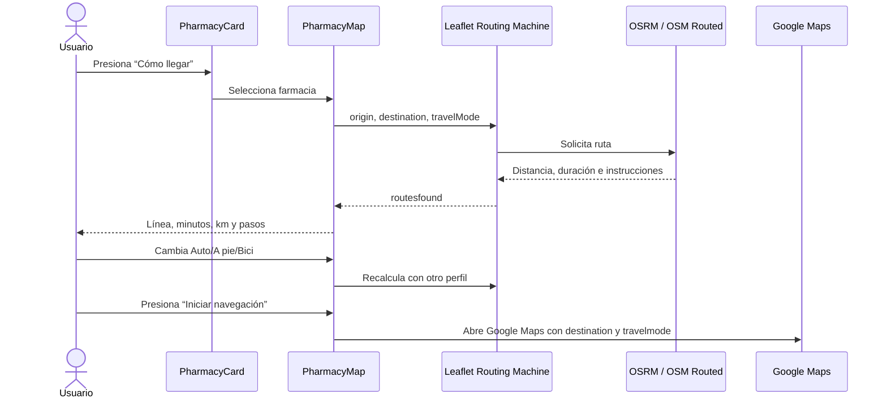

# FarmaYa AR — documentación técnica

## 1. Propósito

FarmaYa AR permite consultar farmacias de turno y permanentes de Jujuy, ubicarlas en un mapa, calcular rutas y recibir feedback de los usuarios.

La solución está dividida en dos aplicaciones:

- `ar.farmacias-ui`: frontend Next.js 16 con App Router, componentes shadcn/ui `base-nova` sobre Base UI, Leaflet y TanStack Query.
- `ar.farmacias-core`: API NestJS 11 con CQRS, Mongoose/MongoDB, scraping HTML, geocodificación, rate limiting y validación de feedback.

La fuente oficial de turnos es `https://turnosjujuy.com.ar/`. La información se obtiene del HTML renderizado y de los enlaces/coordenadas publicados por esa página. No se utiliza scraping de PDF ni normalización mediante IA.

## 2. Arquitectura general



### Principios de comunicación

1. El navegador no conoce `FARMACIAS_API_URL` ni llama directamente al core.
2. Las consultas del frontend pasan por las Route Handlers de Next.js.
3. El BFF agrega timeout, normaliza errores y reenvía las solicitudes al core.
4. El core es responsable de validación, autorización de origen, rate limiting, scraping y persistencia.
5. Turnstile se valida siempre en servidor cuando `TURNSTILE_SECRET_KEY` está configurada.

## 3. Flujo de consulta de farmacias cercanas

Endpoint público del BFF:

```text
GET /api/pharmacies/nearby?lat=-24.1858&lng=-65.3028&radius=5000&date=2026-10-10T15:00:00.000Z
```

Endpoint interno del core:

```text
GET http://localhost:5001/api/pharmacies/nearby
```



### Ventana de turno

Los turnos diarios publicados como `de 8:00 a 8:00` se almacenan como una ventana de 24 horas:

```text
dutyFrom  = fecha de turno 08:00
dutyUntil = día siguiente 08:00
```

Antes de las 08:00, el turno vigente corresponde al día anterior. Las farmacias `Permanente` mantienen `isPermanentlyOnDuty: true` y también aparecen en el turno en curso.

## 4. Consulta por fecha y localidad

Endpoint del BFF:

```text
GET /api/pharmacies/by-date?date=2026-10-10T15:00:00.000Z&city=SAN%20SALVADOR%20DE%20JUJUY
```

El parámetro `city` es opcional. Sin localidad, devuelve las farmacias de todas las localidades disponibles para esa fecha.



## 5. Scraping oficial HTML de Jujuy

### Fuentes y request

Consulta inicial:

```text
GET https://turnosjujuy.com.ar/
```

Consulta por localidad, equivalente al formulario original:

```http
POST https://turnosjujuy.com.ar/
Content-Type: application/x-www-form-urlencoded

localidad=CALILEGUA
```

El scraper:

- lee `select[name="localidad"]` para descubrir localidades;
- procesa filas `tr.item-farmacia-target`;
- usa cards `.list-group-item.item-farmacia-target` como fallback mobile;
- extrae ciudad, nombre, contacto, horario, estado y `data-farmacia-id`;
- extrae coordenadas del enlace específico de Google Maps;
- usa `var puntos = [...]` como fallback de coordenadas publicado en el HTML;
- detecta `Permanente` y la incorpora al turno vigente;
- guarda el HTML crudo resumido en `raw_data`.



### Validaciones antes de guardar

Cada registro debe tener:

- `sourceId`;
- nombre;
- dirección;
- coordenadas completas o posibilidad de geocodificación.

También se valida:

- rango de latitud `[-90, 90]` y longitud `[-180, 180]`;
- que un mismo `sourceId` no cambie de nombre/dirección sin ser rechazado;
- coordenadas compartidas por varias farmacias, que generan warning para revisión;
- consistencia contra el registro persistido anterior para evitar cruzar Botica, Belgrano o Farmacity.



### Limpieza de registros viejos

Después del scraping se toma la ventana actual (`dutyFrom`, `dutyUntil`) y se eliminan:

- turnos de ventanas anteriores;
- farmacias cuyo `sourceId` ya no aparece en la fuente actual;
- duplicados del mismo `sourceId` dentro de la ventana actual.

Esto permite ejecutar el scraper varias veces sin acumular datos viejos ni duplicar turnos.



## 6. Geocodificación

Las coordenadas oficiales extraídas del HTML tienen prioridad. Solo se geocodifica cuando no hay una ubicación válida.

Orden actual:

1. Google Geocoding, si existe `GOOGLE_MAPS_API_KEY`.
2. Nominatim/OpenStreetMap como fallback.
3. Si ambas fallan, se conserva la farmacia sin ubicación nueva y se registra warning.



## 7. Estado del scraper y monitoreo

El core guarda una ejecución en `scraping_runs` con:

```text
source
status: running | success | failed
startedAt / finishedAt
recordsFound
recordsValidated
recordsSaved
staleRemoved
errorMessages[]
structureChanges[]
```

Consulta:

```text
GET /api/scraping/turnos-jujuy/status
```

La UI lo consume mediante:

```text
GET /api/scraping/turnos-jujuy/status
```

El componente `ScraperMonitor` muestra la última ejecución, cantidad encontrada, validada, guardada, eliminada y cambios de estructura.

## 8. Feedback, Turnstile y Telegram opcional

El formulario de feedback está en el frontend. El token de Turnstile nunca se considera válido solo porque exista: el backend lo verifica contra Cloudflare.



### Variables del feedback

Frontend (`ar.farmacias-ui/.env.local`):

```env
FARMACIAS_API_URL=http://localhost:5001
NEXT_PUBLIC_TURNSTILE_SITE_KEY=...
```

Core (`ar.farmacias-core/.env`):

```env
TURNSTILE_SECRET_KEY=...
TURNSTILE_HOSTNAMES=localhost,127.0.0.1
TELEGRAM_BOT_TOKEN=
FEEDBACK_CHAT_ID=
```

Telegram es opcional. Sin sus variables, el feedback se guarda en MongoDB y no se envía ninguna notificación.

En producción, `TURNSTILE_HOSTNAMES` debe contener únicamente hostnames productivos; no debe incluir `localhost` ni `127.0.0.1`.

Los valores no llevan protocolo, rutas ni puertos:

```env
# Desarrollo
TURNSTILE_HOSTNAMES=localhost,127.0.0.1

# Producción de ejemplo
TURNSTILE_HOSTNAMES=farmaya.ar,www.farmaya.ar
```

Los mismos hostnames deben estar configurados en el widget de Turnstile dentro de Cloudflare.

## 9. Mapa, rutas y navegación

### Mapa

Leaflet/React Leaflet muestra tiles de Google Maps en modo mapa de calles:

```text
https://mt1.google.com/vt/lyrs=m&x={x}&y={y}&z={z}
```

No se muestra el control de capas. Street View se abre como enlace externo de Google Maps para la farmacia seleccionada.

### Routing Machine

La ruta se calcula desde la ubicación del usuario hasta la farmacia seleccionada. Los modos son:

- auto: OSRM público;
- caminando: servidor OSM Routed Foot;
- bicicleta: servidor OSM Routed Bike.



La ruta se cancela durante el desmontaje del mapa para evitar el error de Leaflet `removeLayer` cuando una respuesta asíncrona llega después de cambiar de farmacia o desmontar el componente.

## 10. Seguridad y límites

### CORS/orígenes

El feedback valida `Origin` y `Referer` contra `FRONTEND_URL`. En desarrollo se aceptan también `http://localhost:3000` y `http://127.0.0.1:3000`.

### Rate limit

- Throttler global del core: 100 solicitudes por minuto.
- Feedback: máximo 5 mensajes por IP en una ventana de una hora.
- Feedback global: máximo 40 mensajes por hora en la instancia.
- El endpoint de scraping admite `x-auth-token: Bearer <CRON_SECRET>` cuando `CRON_SECRET` está configurado.

### Autenticación

Actualmente no se utiliza login, Google OAuth ni JWT en la aplicación pública. El frontend no tiene módulo de autenticación activo.

## 11. Endpoints

### BFF de Next.js

| Método | Ruta | Función |
|---|---|---|
| GET | `/api/pharmacies/nearby` | Farmacias cercanas |
| GET | `/api/pharmacies/by-date` | Turnos por fecha/localidad |
| GET | `/api/scraping/turnos-jujuy/status` | Último estado del scraper |
| POST | `/api/feedback` | Enviar feedback |
| OPTIONS | `/api/feedback` | Preflight |
| GET | `/api/health` | Proxy de health del core |

### Core NestJS

| Método | Ruta | Función |
|---|---|---|
| GET | `/health` | Estado del servicio |
| GET | `/api/pharmacies/nearby` | Consulta geográfica |
| GET | `/api/pharmacies/by-date` | Consulta por fecha/localidad |
| GET | `/api/scraping/turnos-jujuy/status` | Estado de scraping |
| GET | `/api/scraping/turnos-jujuy` | Ejecuta scraping HTML |
| POST | `/api/feedback` | Valida y guarda feedback |
| OPTIONS | `/api/feedback` | Preflight de origen |

## 12. Arranque local

### MongoDB

El core necesita MongoDB accesible en la URL configurada por `MONGODB_URI`. Si se usa Colima/Docker:

```bash
colima start
docker compose up -d
```

### Core

```bash
cd ar.farmacias-core
pnpm install
pnpm start:dev
```

Por defecto escucha en `http://localhost:5001`.

### UI

```bash
cd ar.farmacias-ui
pnpm install
pnpm dev
```

Por defecto escucha en `http://localhost:3000`.

Si se modifican variables `NEXT_PUBLIC_*`, hay que reiniciar Next.js porque se incorporan al bundle del cliente durante el arranque.

## 13. Variables de entorno

### Core

| Variable | Obligatoria | Descripción |
|---|---:|---|
| `MONGODB_URI` | Sí | URI de MongoDB |
| `FRONTEND_URL` | Sí | Origen permitido del frontend |
| `PORT` | No | Puerto HTTP, por defecto 5001 |
| `CRON_SECRET` | Recomendado | Protege el trigger del scraper |
| `TURNSTILE_SECRET_KEY` | En producción | Secret server-side del widget |
| `TURNSTILE_HOSTNAMES` | En producción | Hostnames esperados por Siteverify |
| `GOOGLE_MAPS_API_KEY` | No | Geocodificación de alta precisión |
| `TELEGRAM_BOT_TOKEN` | No | Bot de notificación de feedback |
| `FEEDBACK_CHAT_ID` | No | Chat destino de Telegram |

### UI

| Variable | Obligatoria | Descripción |
|---|---:|---|
| `FARMACIAS_API_URL` | Sí | URL privada del core, usada solo por el BFF |
| `NEXT_PUBLIC_TURNSTILE_SITE_KEY` | En producción | Site key pública del widget |

No se deben volver a agregar `JWT_SECRET`, `GOOGLE_CLIENT_ID`, `GOOGLE_CLIENT_SECRET` ni `GOOGLE_CALLBACK_URL`: el módulo de autenticación fue retirado del alcance actual.

## 14. Mantenimiento y diagnóstico

### El scraper devuelve cero registros

1. Probar `https://turnosjujuy.com.ar/` manualmente.
2. Revisar si siguen existiendo `tr.item-farmacia-target` o las cards mobile.
3. Revisar `ScrapingRun.structureChanges`.
4. Validar que la localidad enviada use el valor exacto del `<option>`.

### Faltan permanentes

Revisar que el HTML tenga `Permanente` en la columna de horario. El parser debe marcar:

```text
isPermanentlyOnDuty = true
isOnDuty = true
```

### Farmacias cruzadas o coordenadas repetidas

Revisar los warnings `[Validation]` del handler. Nunca corregir manualmente solo la coordenada sin comprobar `sourceId`, nombre, dirección y enlace específico de Google Maps.

### Feedback no enviado

Comprobar en este orden:

1. Que `challenges.cloudflare.com` no esté bloqueado por el navegador.
2. Que la site key incluya el hostname actual.
3. Que `TURNSTILE_SECRET_KEY` corresponda al mismo widget.
4. Que `TURNSTILE_HOSTNAMES` coincida con el hostname que devuelve Siteverify.
5. Que MongoDB esté conectado.
6. Si el feedback se guarda pero no llega a Telegram, revisar únicamente `TELEGRAM_BOT_TOKEN` y `FEEDBACK_CHAT_ID`.

## 15. Decisiones y exclusiones

- Fuente de turnos: HTML oficial de Jujuy.
- Persistencia: MongoDB/Mongoose.
- Transporte frontend-core: BFF de Next.js.
- UI: shadcn/ui `base-nova` con Base UI.
- Mapas: Leaflet con tiles de Google en vista de calles.
- Ruteo: Leaflet Routing Machine con OSRM/OSM Routed.
- CAPTCHA: Cloudflare Turnstile con validación server-side.
- Notificaciones: Telegram opcional.
- No se usa PDF scraper.
- No se usa `ai-normalizer`.
- No se usa autenticación pública.

